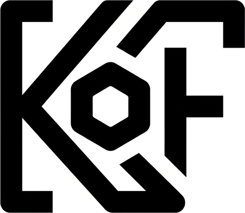
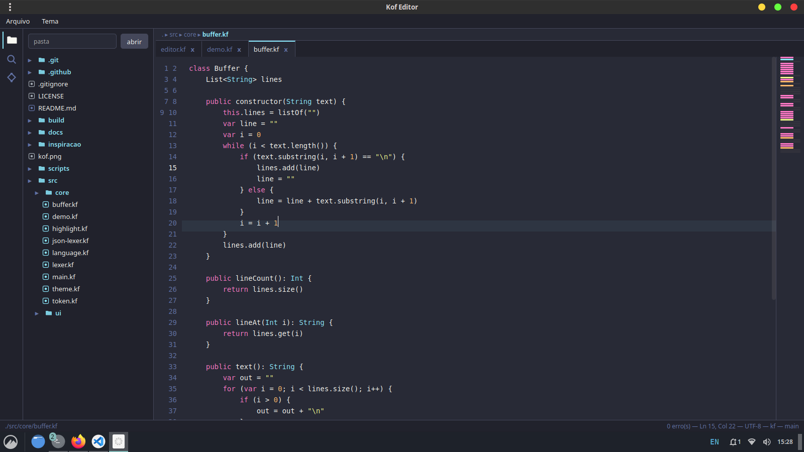

# Kof Editor

<p align="center">
  
</p>

### Uma linguagem. Um editor. Vários mundos.

O **Kof Editor** é um editor de texto escrito **inteiramente em Kof** — a
linguagem de programação multi-target (JVM, nativo e web) desenvolvida no
projeto [Kof4j](https://github.com/KofLang/Kof4j).

É uma **prova de conceito**: todo o editor — lexer, highlight, árvore de
arquivos, abas, terminal integrado, integração com git, temas, paleta de
comandos — é código Kof, servido por `kof serve` e exibido em uma janela
nativa Linux (WebKitGTK). O editor usa as mesmas peças do compilador que
escreve: o lexer de Kof é o lexer do editor.

> **Sem extensões.** Reconhecimento de linguagem, erros, terminal e git
> são nativos — as mesmas APIs do runtime Kof (`process.run`).

---

## Screenshot

<p align="center">
  
</p>

---

## Status

- **Janela nativa** (WebKitGTK) com editor completo: abas, explorer em
  árvore, gutter, highlight, linha ativa, minimap, temas claro/escuro
- **Painel inferior** com abas: Problemas | Saída | Terminal | Git
- **Git integrado**: branch, status, diff e commit via `process.run`
- **Terminal**: executa comandos via shell do host (não-interativo por ora)
- **Paleta de comandos** (Ctrl+Shift+P), Quick Open (Ctrl+P), símbolos
  (Ctrl+Shift+O), snippets, busca por arquivo e por texto
- **Núcleo rodando na JVM e no KofJS** (GraalJS) — revalidado no
  **Kof 0.2.3-beta** (29/08/2026), saída idêntica nos dois. O target
  **nativo regrediu** nesse release (o scanner completo cracha no ELF —
  regressão R1 do NativeBackend; ver
  [`docs/08-restricoes-kof.md`](docs/08-restricoes-kof.md)); no Kof 0.0.14 o
  ELF rodava com paridade byte a byte. Release via `scripts/release.sh`

```bash
kof-editor              # abre a janela
kof-editor caminho.kf   # abre com um arquivo
kof-editor --stop       # para servidor e janela
```

## Estrutura

```text
├── src/
│   ├── core/           # o editor em Kof: lexer, token, language, theme, highlight
│   └── ui/
│       ├── front.kf    # funções Kof: arquivos, busca, git, outline, diags
│       └── web/        # a interface (HTML/CSS/JS gerados por Kof)
├── scripts/
│   ├── web-combine.sh  # junta os módulos em build/editor-web.kf
│   ├── install.sh      # instala o launcher kof-editor no sistema
│   └── release.sh      # empacota tarballs JVM/native em dist/
├── docs/               # visão, estratégia, arquitetura, restrições do Kof
└── inspiracao/         # referências de produto (não versionado)
```

## Documentação

Comece por [`docs/README.md`](docs/README.md).

## Roadmap em uma frase

Núcleo (1) → arquivos (2) → terminal nativo (3) → UI (4) → análise
profunda/autocomplete (5) → binário nativo (6) → web (7, fora do escopo
atual) → plataforma (8).

## Release

```bash
scripts/release.sh --jvm     # tarball JVM em dist/
scripts/release.sh --native  # nativo (aguarda process.run no target native)
```

Pipeline de release no GitHub Actions (`.github/workflows/release.yml`):
builda o Kof, o webview com ícone e empacota os tarballs a cada tag `v*`.

## Compilador

O projeto depende do compilador Kof em desenvolvimento. Bugs encontrados
durante a construção e seus workarounds estão em
[`docs/08-restricoes-kof.md`](docs/08-restricoes-kof.md).

## Licença

GPL-3.0 — ver `LICENSE`.

**Kof Editor** — *Menos código. Mais intenção. Vários mundos.*